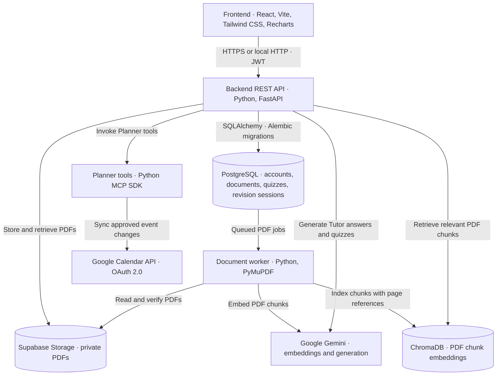

<div align="center">


[](https://react.dev/)
[](https://fastapi.tiangolo.com/)
[](https://www.postgresql.org/)
[](https://ai.google.dev/)

</div>

---

## 🧠 About

**AI Study Buddy** is a study workspace that turns course PDFs into answers with page citations, practice quizzes, and revision plans.

**Upload notes → Ask questions → Take a quiz → Review weak topics → Plan revision**

## ✨ Features

| Feature | What you can do |
| --- | --- |
| 📚 **Document Library** | Upload private PDFs, preview them, and organize them by subject. |
| 💬 **AI Tutor** | Ask questions about selected PDFs and check answers against page citations. |
| 📝 **Quiz Studio** | Generate quizzes, review graded attempts, and practice weak topics. |
| 📊 **Learning Analytics** | Explore quiz performance, study activity, and revision completion. |
| 🗓️ **Revision Planner** | Schedule study sessions locally or sync them to Google Calendar after approving each event change. |

## 🛠️ Tech Stack

| Layer | Stack |
| --- | --- |
| Frontend | React, Vite, Tailwind CSS, Recharts |
| Backend | Python, FastAPI, SQLAlchemy, Alembic |
| Data | PostgreSQL, private Supabase Storage, ChromaDB |
| AI & integrations | Gemini, PyMuPDF, Model Context Protocol, Google Calendar OAuth |

## 🏗️ Architecture



## 🚀 Run Locally

You'll need Python, Node.js with npm, and Docker Compose.

**1. Create a local `.env` in the repository root.** Set `POSTGRES_USER`, `POSTGRES_PASSWORD`, `POSTGRES_DB`, `DATABASE_URL`, and `JWT_SECRET_KEY`. Point `DATABASE_URL` at your PostgreSQL database using `postgresql+psycopg://`. Compose exposes PostgreSQL on port `5433` by default.

For PDF and AI features, configure a private Supabase bucket using `SUPABASE_URL`, `SUPABASE_SECRET_KEY`, and `SUPABASE_STORAGE_BUCKET`. Set `GEMINI_API_KEY` and set `GEMINI_FREE_TIER_CONFIRMED=true` only after confirming your Gemini project is on the Free tier. Google Calendar is optional.

**2. Start the databases and API.** These commands use Git Bash on Windows.

```bash
docker compose up -d postgres chroma
cd backend
python -m venv .venv
source .venv/Scripts/activate
python -m pip install -r requirements.txt
python -m alembic upgrade head
python -m uvicorn app.main:app --host 127.0.0.1 --port 8000 --no-access-log
```

In a second terminal, activate the same virtual environment from `backend` and run `python -m app.document_worker` to index uploaded PDFs.

**3. Start the frontend** from the repository root in a separate terminal.

```bash
cd frontend
npm ci
npm run dev
```

Open [AI Study Buddy](http://127.0.0.1:5173).

---

<div align="center">


</div>
